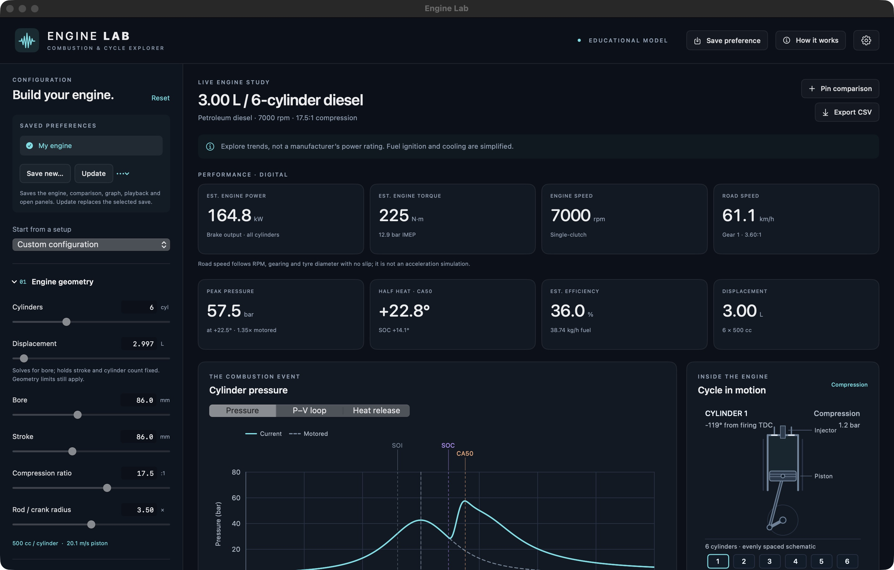

# Engine Lab

A native macOS engine simulator for exploring how geometry, fuel, ignition timing, cooling, and gearing affect a four-stroke engine. Built with SwiftUI and a Swift thermodynamics model, with interactive graphs and an animated piston and cylinder bank.



Engine Lab is an **educational model** for comparing trends. Its pressure, power, torque, and efficiency estimates are not calibrated predictions for a particular engine.

## Features

| Area | What you can explore |
| --- | --- |
| Engine geometry | 1–16 cylinders, bore, stroke, total displacement, compression ratio, and connecting-rod geometry |
| Fuels | Petroleum diesel, B20, B100, petrol/E0, E10, and a nominal E85 blend |
| Petrol grades | 92, 95, and 98 RON; 87, 89, 91, and 93 AKI; or an unspecified grade |
| Combustion timing | Injection or spark timing, automatic or manual ignition delay, start of combustion, and heat-release duration |
| Operating conditions | RPM, fuel input, intake pressure and temperature, and volumetric efficiency |
| Gearbox | Single-clutch, dual-clutch, or CVT; gear ratios, final drive, tyre diameter, and transmission efficiency |
| Cooling and pressure | Liquid, air, or insulated cooling assumptions; heat-transfer settings; predicted or target peak pressure |
| Results | Pressure versus crank angle, pressure–volume loop, heat release, estimated engine output, and wheel torque |
| Display | Digital readings or an instrument cluster for power, torque, RPM, and road speed |
| Preferences | English or Simplified Chinese, metric or US output units, autosave, and named setups |
| Comparison and export | Pinned reference curves, portable JSON sessions, and cycle data in CSV format |

Petrol grades are saved labels in this version. Choosing a different octane rating does not change the simulation; knock and automatic timing adaptation are not modeled.

## Build and run

### Requirements

- macOS 14 or later.
- Apple's Xcode Command Line Tools, including the Swift compiler and macOS SDK.
- A Mac with permission to write to the project folder and its parent directory.

The native app has no third-party package dependencies and runs offline. It does not require Node.js, a browser, or a local server.

Install the Command Line Tools if needed:

```sh
xcode-select --install
```

From the directory containing this README, run:

```sh
./build-mac-app.sh
open "../Engine Lab.app"
```

The build script creates **Engine Lab.app one directory above this folder**, with temporary build files in `.native-build/`. Quit Engine Lab before rebuilding; the script updates the same app bundle. You can move the completed app into Applications and launch it normally.

The build uses the host Mac's architecture. Apple Silicon has been tested; Intel builds have not been verified. The script creates an ad hoc signed local app, not a notarized distribution release.

## Using the simulator

1. **Choose a starting setup.** Select a preset, then adjust the controls in the sidebar. Editing total displacement recalculates bore while preserving stroke and cylinder count.
2. **Explore fuel and timing.** Change the fuel, injection or spark timing, ignition delay, and heat-release duration. Compare the start of combustion with the pressure peak and CA50, the point where half the modeled heat has been released.
3. **Set the gearbox.** Section **04 · Gearbox** provides 1–8 forward gears for single- and dual-clutch configurations, or an adjustable continuous ratio for CVT. Set the active gear, final drive, tyre diameter, and transmission efficiency.
4. **Adjust cooling and pressure.** Section **05 · Cooling & pressure** predicts peak pressure from fuel input or searches for the fuel input needed to reach a target. Unreachable targets are identified.
5. **Compare results.** Use **Pin comparison** before changing a parameter, then switch between pressure, P–V, and heat-release graphs. Pause or scrub the animation to inspect individual crank positions.

Open the **gear icon** at the upper right to choose the digital display or instrument cluster, switch between English and Simplified Chinese, and select output units.

| Output units | Power | Torque | Road speed |
| --- | --- | --- | --- |
| Metric | kW | N·m | km/h |
| US customary | hp | lb-ft | mph |

Geometry and combustion inputs retain mm, L, bar, and °C in both modes. Instrument scales adapt to the calculated values; they do not represent engine redlines or mechanical limits.

## Saving and exporting

The current working session is saved automatically and restored when the app reopens. **Save preference** creates a named snapshot that you can load from the sidebar. Named snapshots stay unchanged while you experiment; **Update** replaces the selected snapshot, and the nearby menu provides Rename and Delete.

A session includes engine and gearbox settings, the pinned comparison, selected graph, animation position and playback settings, expanded panels, language, display style, and output units.

| Action | Shortcut | Result |
| --- | --- | --- |
| Save preference | ⌘S | A named snapshot stored locally |
| Export Session | ⇧⌘S | A portable JSON backup of the current session |
| Import Session | ⌘O | Restore a session from JSON |
| Export CSV | ⌘E | Export 1,441 samples from the current engine cycle |

Use **Export Session** for a portable backup. A session export contains the current session, rather than the entire library of named preferences. The file dialog accepts a destination path directly or through **Browse**. Its default folder is `Engine Lab Files` beside the app when writable, with Documents as the fallback.

## Model and limitations

The simulator uses a simplified, single-zone, four-stroke thermodynamic model with slider-crank geometry, prescribed heat release, and approximate heat loss and friction. See [MODEL.md](MODEL.md) for equations, assumptions, and technical references. **How it works** inside the app explains the main quantities.

- **Fuel and combustion:** Fuel properties and ignition delay are representative approximations. Fuel input scales heat input at fixed trapped air; it is not a full throttle or load controller. Octane-dependent knock, emissions, detailed injection, and chemical kinetics are not simulated.
- **Pressure control:** Target-pressure mode searches within the available 0–100% fuel-input range. It reports unreachable targets instead of forcing a requested pressure.
- **Output:** Main power and torque readings estimate engine brake output across all cylinders. Wheel torque is reported separately in Gearbox. Results are unsuitable for engine tuning, component sizing, or manufacturer power claims.
- **Transmission:** Road speed follows RPM, gear ratio, final drive, and tyre diameter with a fully engaged drivetrain and no slip. There is no acceleration, road-load, shift-time, or automatic CVT-control model. Single- and dual-clutch types produce the same steady result at identical ratios and efficiency. Displayed speed is not a predicted achievable top speed.
- **Animation:** Playback shows the cycle in slow motion, independently of engine RPM. The cylinder bank is an evenly spaced schematic, not a manufacturer-specific firing-order model. Stroke means piston travel; the simulated cycle remains four-stroke.

## Development and checks

Run the native checks on macOS with the Command Line Tools installed:

```sh
native/tests/run-checks.sh
native/tests/run-preference-checks.sh
native/tests/run-state-checks.sh
```

The suites cover numerical behavior, configuration compatibility, gearbox and unit calculations, session storage, named preferences, and state restoration. Preference checks use isolated storage domains and include restoration in a separate process.

| Source | Purpose |
| --- | --- |
| [native/EngineLab.swift](native/EngineLab.swift) | App lifecycle, menus, and file dialogs |
| [native/EngineLabView.swift](native/EngineLabView.swift) | Main dashboard and engine controls |
| [native/EngineModel.swift](native/EngineModel.swift) | Geometry, combustion, and thermodynamic calculations |
| [native/EngineGearbox.swift](native/EngineGearbox.swift) | Transmission calculations |
| [native/EngineLabState.swift](native/EngineLabState.swift) | Live state, autosave, and saved-setup actions |
| [native/EnginePreferences.swift](native/EnginePreferences.swift) | Session format, persistence, and compatibility |
| [native/EngineVisuals.swift](native/EngineVisuals.swift) | Charts and piston animation |
| [native/EngineInstruments.swift](native/EngineInstruments.swift) | Instrument-cluster gauges |
| [native/EngineSettingsView.swift](native/EngineSettingsView.swift) | Display, language, and unit settings |
| [native/tests/](native/tests/) | Automated native checks |
| [build-mac-app.sh](build-mac-app.sh) | Compile and package the native app |

### Earlier browser prototype

The HTML, CSS, and JavaScript files are retained as an earlier prototype and model reference. The native app runs independently of them. To work on the prototype, install Node.js and run:

```sh
node --test model.test.mjs
node build.mjs
node serve.mjs
```

The server prints its local URL. `index.html` is generated from the prototype source files; rebuild it after changes. The prototype is separate from the current native feature set.
